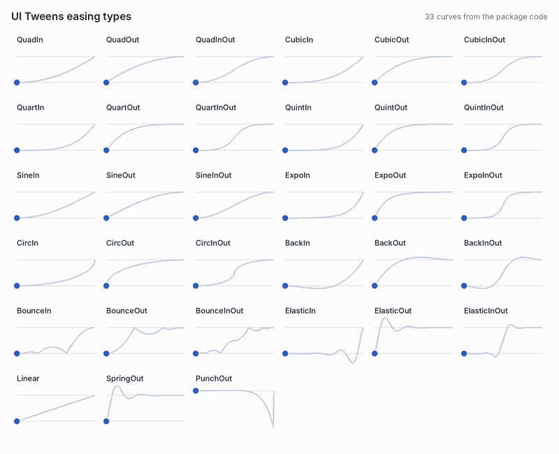

# API Reference

[← Back to README](../README.md)

- [Tween methods](#tween-methods)
- [Tween options](#tween-options)
- [Controlling tweens](#controlling-tweens)
- [Easing](#easing)
- [Runtime behavior](#runtime-behavior)

---

## Tween methods

Every method ends with the same three parameters: `float duration`, `EaseType ease = EaseType.Linear` and `float easeParameter = -1f`.

| Target | Method | Values before `duration` |
|---|---|---|
| `RectTransform` | `DOAnchorPos` | `Vector2 targetPos` |
| | `DOAnchorPosX`, `DOAnchorPosY` | `float targetX`, `float targetY` |
| | `DOScale` | `Vector3 targetScale` |
| | `DOScaleX`, `DOScaleY`, `DOScaleZ` | `float targetX`, `float targetY`, `float targetZ` |
| | `DORotate` | `float targetRotation` |
| | `DOSizeDelta` | `Vector2 targetSize` |
| | `DOPivot` | `Vector2 targetPivot` |
| `Graphic` (`Image`, `RawImage`, `Text`, TextMeshPro) | `DOFade` | `float targetAlpha` |
| | `DOColor` | `Color targetColor` |
| | `DOColorFromTo` | `Color startColor`, `Color endColor` |
| `Image` | `DOFillAmount` | `float targetFill` (0 to 1) |
| `CanvasGroup` | `DOFade` | `float targetAlpha` |
| | `DOFadeFromTo` | `float startAlpha`, `float endAlpha` |

`easeParameter` adjusts curves that support it, such as the overshoot of `Back`.

For values that aren't tied to a UI component, see [Animate a custom value](code-examples.md#animate-a-custom-value).

## Tween options

| Method | Purpose |
|---|---|
| `Delay(seconds)` | Wait before starting |
| `Loop(repeatCount)` | Repeat after the first play, so `Loop(2)` plays three times |
| `LoopInfinite()` | Repeat until cancelled |
| `Loop(n, LoopType.Yoyo)`, `LoopInfinite(LoopType.Yoyo)` | Play back and forth instead of restarting |
| `From()` | Play from the given value to the current one. The target jumps to the given value at once |
| `Relative()` | Treat the given value as an offset from where the tween starts |
| `IgnoreTimeScale()` | Keep playing when `Time.timeScale` is `0`, for example on a pause menu |
| `WhenDisabled(behaviour)` | Keep playing, pause, cancel or complete when the target's GameObject is disabled |
| `Then(handle)` | Run another tween when this one finishes |
| `OnStart(callback)` | Run code when the tween starts |
| `OnUpdate(callback)` | Run code on each update |
| `OnFloatUpdate(callback)`, `OnVectorUpdate(callback)` | Receive the current value of a custom tween |
| `OnComplete(callback)` | Run code when the tween finishes |
| `OnComplete(state, callback)` | Same, and passes `state` to the callback. It doesn't allocate if the callback captures nothing |
| `GetHandle()` | Get a `TweenHandle` for later control |
| `DeclareOnly()` | Hold a tween so it can be passed to `Sequential()` |

## Controlling tweens

These work on `RectTransform`, any `Graphic` and `CanvasGroup`, and apply to the tweens tracked for that component:

```csharp
panel.DoPause();
panel.DoPlay();
panel.DoTogglePause();
panel.DoCancel().OnComplete(() => Debug.Log("Cancelled"));
```

After `DoCancel()`, `OnComplete` is the cancellation callback. It runs when the cancellation is processed, or immediately if there's nothing to cancel.

To control one tween, keep its handle:

```csharp
TweenHandle handle = panel.DOAnchorPosX(200f, 0.5f, EaseType.QuadOut).GetHandle();

TweenManager.Pause(handle);
TweenManager.Resume(handle);
TweenManager.Cancel(handle);
```

`TweenHandle` also has `IsPlaying`, `IsPaused`, `IsCancelled` and `IsFinished`.

To skip to the end or play again, use `Complete`, `Restart` and `Rewind`:

```csharp
TweenManager.Complete(handle);   // jump to the end; OnComplete runs on the next update
TweenManager.Restart(handle);    // play again from the start, with its delay
TweenManager.Rewind(handle);     // back to the start, paused; Resume() plays it again

panel.DoComplete();              // the same, for every tween on a component
panel.DoRestart();
panel.DoRewind();
```

`Restart` and `Rewind` work while the tween still exists: playing, paused, delayed or looping. `Complete` on a loop ends where its last play would; an infinite loop ends at its target.

### When the GameObject is disabled

Tweens keep playing on a disabled GameObject by default. For pooled UI, choose what happens instead:

```csharp
toast.DOAnchorPosY(0f, 0.3f).WhenDisabled(DisableBehaviour.Pause);   // or Cancel, Complete

TweenManager.DisableBehaviourByDefault = DisableBehaviour.Pause;     // for every new tween
```

`DisableBehaviour.Pause` also reacts to a disabled parent, and holds a delay too.

## Easing



| Family | Types |
|---|---|
| Linear | `Linear` |
| Quad, Cubic, Quart, Quint | `In`, `Out` and `InOut` of each, such as `QuadIn` |
| Sine, Expo, Circ | `In`, `Out` and `InOut` of each, such as `SineOut` |
| Back, Bounce, Elastic | `In`, `Out` and `InOut` of each, such as `BackOut` |
| Other | `SpringOut`, `PunchOut` |

The easing curves follow the standard easing equations by Robert Penner.

## Runtime behavior

- Tweens use `Time.deltaTime`, so they stop when `Time.timeScale` is `0`, unless they use `IgnoreTimeScale()`. Set `TweenManager.IgnoreTimeScaleByDefault = true` to make every tween ignore it.
- `TweenManager` persists across scene loads.
- Tweens are cancelled when their target is destroyed.
- When a delayed tween starts on a `RectTransform`, it cancels other tweens animating the same property.
