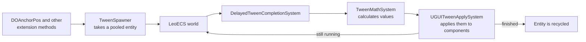

# Core Concepts

[← Back to README](../README.md)

- [Architecture](#architecture)
- [Startup and the tween pool](#startup-and-the-tween-pool)
- [How it compares](#how-it-compares)

---

## Architecture

Tweens run in an always-running ECS world, rather than in objects that appear and disappear.



`TweenManager` runs these systems once per frame.

- `TweenManager` owns the execution loop and lifecycle cleanup.
- `TweenBuilder` composes tween behavior and callbacks.
- `TweenSpawner` creates tween entities in the LeoECS world.
- Systems such as `TweenMathSystem` and `UGUITweenApplySystem` update and apply values.
- `TweenTracker` connects components to their active tweens.

## Startup and the tween pool

UI Tweens does nothing at startup. The first tween sets it up, unless `Initialize()` or `Prewarm()` already did. To start it automatically after the first scene loads instead, with the work spread across a few frames, set `autoStart` to true.

Tween entities are prepared in small batches after setup, so none of that work lands on your first frame. Call `Configure` before the first scene loads to change the defaults:

```csharp
[RuntimeInitializeOnLoadMethod(RuntimeInitializeLoadType.BeforeSceneLoad)]
private static void ConfigureTweens()
{
    TweenManager.Configure(initialPoolSize: 100);
}
```

| Setting | Default |
|---|---|
| `initialPoolSize` | 50. Entities prepared after setup. |
| `refillThreshold` | 2. The pool refills on the next update when this many entities or fewer are left. |
| `growthBatchSize` | 12. Entities added per update while filling or refilling. Set it to 0 to turn refills off. |
| `autoStart` | False. Set it to true to start setup after the first scene loads. |
| `startupDelayFrames` | 30. With `autoStart`, frames to wait after the first scene loads. |

To do all of this during a loading screen, call `Prewarm`. It finishes setup at once, and prepares entities and the position, alpha and scale tween types:

```csharp
TweenManager.Prewarm(100);
```

- **After a tween ends:** its entity returns to the pool for the next tween, and old handles to it stop working.
- **When more tweens run at once than ever before:** the pool grows, which can allocate memory, and tweens keep working. It doesn't shrink.

## How it compares

| | UI Tweens | [DOTween](https://dotween.demigiant.com/) | [PrimeTween](https://github.com/KyryloKuzyk/PrimeTween) | [LitMotion](https://github.com/annulusgames/LitMotion) |
|---|---|---|---|---|
| Focus | Unity UI | General purpose | General purpose | General purpose |
| Allocations | Pools tweens. No garbage collections in 17 benchmark scenarios. See [Performance](performance.md). | Recycles tweens to reduce allocations | Advertises no runtime allocations | Advertises zero allocations, including tween creation |
| Sequences | `Then` and `Sequential` | Yes | Yes | Yes |
| Unscaled time | Yes | Yes | Yes | Yes |
| TextMeshPro | Color and alpha | Yes, in the paid Pro version | Through examples | Yes |
| Dependencies | LeoECS | None | None | Burst, Collections, Mathematics |
| Track record | Pre-release, single author | Long-established, large community | Established | Established |

**Where the others win:** richer sequencing, wider target support and years of production use. DOTween has the largest ecosystem.

**Where UI Tweens fits:** you want UI animation in an always-running ECS world, with tracking and control per component. If you already use LeoECS, it doesn't add a second runtime model.
