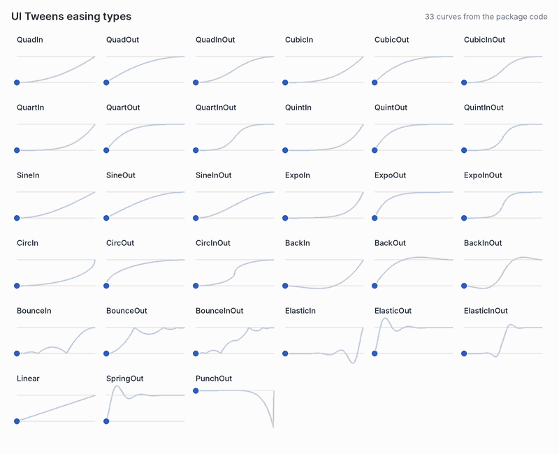
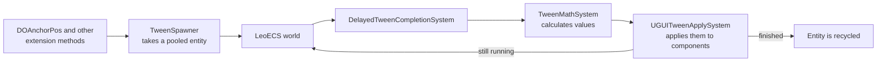

# UI Tweens

**An ECS-based animation engine for Unity UI.**

[](LICENSE)
[](#compatibility)
[](CHANGELOG.md)

UI Tweens runs on LeoECS and provides a fluent API for `RectTransform`, `Image` and `CanvasGroup`, with chaining, loops, callbacks, 33 easing types and per-component pause, resume and cancel controls.

<!-- Demo GIF: Documentation~/images/demo.gif -->

## Why I built it

I've used DOTween Pro for as long as I can remember. When everything goes well, there's no problem. But finding an issue with a tween can be really time-consuming, and that was the main reason I wanted to make my own.

My first idea was a wrapper around DOTween. Then I wondered whether it would be better to run tweens in an always-running world, an ECS, rather than in something that appears and disappears.

That was meant as a possible performance improvement, and it turned out to matter. DOTween works great, but in my experience it can have FPS issues beyond a couple of hundred tweens, and in gameplay they add up very fast.

I built and refined it on my own time in personal projects. It isn't used in production yet. In November 2026 I extracted it into this standalone package, with documentation and tests. Earlier history lives in a private repository.

## Is it right for your project?

**Use UI Tweens if you want:**

- Allocation-conscious UI animation
- A small, fluent API focused on Unity UI
- An ECS-based animation runtime
- Per-component pause, resume and cancel control

**Consider something else if you:**

- Need a mature, general-purpose animation ecosystem. DOTween, PrimeTween and LitMotion are established alternatives.
- Don't want LeoECS in your project.
- Need animations to keep running while `Time.timeScale` is `0`.

## Features

- Runs on LeoECS
- Fluent API for `RectTransform`, `Image` and `CanvasGroup`
- Delays, finite and infinite loops, chaining and callbacks
- 33 built-in easing types
- Per-component pause, resume, toggle and cancel controls
- Custom float and vector tweens
- Automatic cleanup when targets are destroyed
- Configurable pool sizes with `UITweenPoolConfig`

## Compatibility

| Requirement | Supported |
|---|---|
| Unity | Tested on Unity 6 (`6000.3.16f1`). The package declares `2022.3` as its minimum, but older versions aren't tested yet. |
| Scripting backend | Not verified yet |
| Platforms | Not verified yet |
| UI targets | `RectTransform`, `Image`, `CanvasGroup` |
| Enter Play Mode with domain reload disabled | Not verified yet. The package has no static reset for this mode, so keep domain reload on until you've tested it. |
| Dependencies | [LeoECS Core](https://github.com/LeoECSCommunity/ecs) `2022.2.22`, uGUI |

## Installation

Git must be installed on your machine.

UI Tweens requires [LeoECS Core](https://github.com/LeoECSCommunity/ecs) version `2022.2.22`.

### 1. Install LeoECS

1. In Unity, open **Window > Package Manager**.
2. Select **+ > Add package from git URL**.
3. Enter:

```text
https://github.com/LeoECSCommunity/ecs.git#91cc7e390fa0eb4fc88a5cf111df88b1f45af37e
```

Use this exact URL. It points to the last LeoECS release under the standard MIT license. Later releases from other sources use a different license.

UI Tweens uses classic LeoECS (`com.leopotam.ecs`), not LeoECS Lite.

### 2. Install UI Tweens

1. In Unity, open **Window > Package Manager**.
2. Select **+ > Add package from git URL**.
3. Enter:

```text
https://github.com/sgonzalezrozo/unity-ui-tweens.git
```

To pin a release, add its tag:

```text
https://github.com/sgonzalezrozo/unity-ui-tweens.git#v0.3.0
```

## Setup

There's nothing to set up. `TweenManager` creates itself after the first scene loads and spreads its startup work across a few frames, so don't add it to a scene. Check `TweenManager.IsReady` if you need to know when it has finished.

Start tweens from `Start()` or later, not `Awake()`.

## Quick start

```csharp
using UITweens.Extensions;
using UITweens.Math;
using UnityEngine;

public class PanelAnimator : MonoBehaviour
{
    [SerializeField] private RectTransform panel;

    public void Show()
    {
        panel.DOAnchorPos(Vector2.zero, 0.35f, EaseType.BackOut)
            .Delay(0.05f)
            .OnComplete(() => Debug.Log("Panel shown"));
    }
}
```

## Usage example

This component slides a panel in when its screen opens, using [Screen System](https://github.com/sgonzalezrozo/unity-screen-system). It cancels the tween when the screen closes, so a late animation can't move the hidden panel.

```csharp
using ScreenSystem;
using UITweens.Extensions;
using UITweens.Math;
using UnityEngine;

public class SlideInPanel : MonoBehaviour, IScreenLifecycle
{
    private const float Duration = 0.65f;
    private const float EntranceDelay = 0.25f;

    [SerializeField] private RectTransform panel;
    [SerializeField] private EaseType ease = EaseType.QuadOut;

    public void OnScreenShown()
    {
        panel.anchoredPosition = OffscreenPosition;
        panel.DOAnchorPos(Vector2.zero, Duration, ease).Delay(EntranceDelay);
    }

    public void OnScreenHidden()
    {
        panel.DoCancel();
        panel.anchoredPosition = OffscreenPosition;
    }

    private Vector2 OffscreenPosition => new(0f, panel.rect.height);
}
```

To use it without Screen System, remove `IScreenLifecycle` and call these methods yourself.

## Tween methods

Every method ends with the same three parameters: `float duration`, `EaseType ease = EaseType.Linear` and `float easeParameter = -1f`.

| Target | Method | Values before `duration` |
|---|---|---|
| `RectTransform` | `DOAnchorPos` | `Vector2 targetPos` |
| | `DOAnchorPosX`, `DOAnchorPosY` | `float targetX`, `float targetY` |
| | `DOScale` | `Vector3 targetScale` |
| | `DOScaleX`, `DOScaleY`, `DOScaleZ` | `float targetX`, `float targetY`, `float targetZ` |
| | `DORotate` | `float targetRotation` |
| | `DOSizeDelta` | `Vector2 targetSize` |
| | `DOPivot` | `Vector2 targetPivot` |
| `Image` | `DOFade` | `float targetAlpha` |
| | `DOColor` | `Color targetColor` |
| | `DOColorFromTo` | `Color startColor`, `Color endColor` |
| `CanvasGroup` | `DOFade` | `float targetAlpha` |
| | `DOFadeFromTo` | `float startAlpha`, `float endAlpha` |

`easeParameter` adjusts curves that support it, such as the overshoot of `Back`.

## Tween options

| Method | Purpose |
|---|---|
| `Delay(seconds)` | Wait before starting |
| `Loop(repeatCount)` | Repeat after the first play, so `Loop(2)` plays three times |
| `LoopInfinite()` | Repeat until cancelled |
| `Then(handle)` | Run another tween when this one finishes |
| `OnStart(callback)` | Run code when the tween starts |
| `OnUpdate(callback)` | Run code on each update |
| `OnFloatUpdate(callback)`, `OnVectorUpdate(callback)` | Receive the current value of a custom tween |
| `OnComplete(callback)` | Run code when the tween finishes |
| `OnComplete(state, callback)` | Same, and passes `state` to the callback. It doesn't allocate if the callback captures nothing |
| `GetHandle()` | Get a `TweenHandle` for later control |
| `DeclareOnly()` | Hold a tween so it can be passed to `Sequential()` |

## Controlling tweens

These work on `RectTransform`, `Image` and `CanvasGroup`, and apply to the tweens tracked for that component:

```csharp
panel.DoPause();
panel.DoPlay();
panel.DoTogglePause();
panel.DoCancel().OnComplete(() => Debug.Log("Cancelled"));
```

After `DoCancel()`, `OnComplete` is the cancellation callback. It runs when the cancellation is processed, or immediately if there's nothing to cancel.

To control one tween, keep its handle:

```csharp
TweenHandle handle = panel.DOAnchorPosX(200f, 0.5f, EaseType.QuadOut).GetHandle();

TweenManager.Pause(handle);
TweenManager.Resume(handle);
TweenManager.Cancel(handle);
```

`TweenHandle` also has `IsPlaying`, `IsPaused`, `IsCancelled` and `IsFinished`.

## Recipes

### Run tweens in order

Use `Then` to start a tween when another one finishes. It works on the same property too, and the second tween starts from wherever the first one ended:

```csharp
panel.DOAnchorPos(Vector2.zero, 0.35f, EaseType.BackOut)
    .Then(panel.DOAnchorPosX(40f, 0.2f).GetHandle())
    .OnComplete(() => Debug.Log("Both finished"));
```

`Then` returns a builder for the next tween, so `OnComplete` here belongs to the second tween. Cancelling a tween also cancels the ones waiting for it.

For longer sequences, declare each tween, then pass them to `Sequential`. A declared tween waits until it's passed in:

```csharp
TweenSpawner spawner = TweenManager.GetSpawner();

spawner.Sequential(
    panel.DOAnchorPos(Vector2.zero, 0.35f, EaseType.BackOut).DeclareOnly(),
    spawner.Wait(0.2f),
    content.DOFade(1f, 0.2f).DeclareOnly());
```

To overlap two tweens on different properties, use `Delay`:

```csharp
panel.DOAnchorPos(Vector2.zero, 0.35f, EaseType.BackOut);
content.DOFade(1f, 0.2f).Delay(0.25f);
```

### Loop a tween

```csharp
icon.DOScale(Vector3.one * 1.1f, 0.4f, EaseType.SineInOut).LoopInfinite();

// Later:
icon.DoCancel();
```

Each loop restarts from the beginning of the tween. There's no public API for back-and-forth loops yet.

### Animate a custom value

`CustomFloat` and `CustomVector` animate a value that isn't tied to a UI component:

```csharp
using UITweens;
using UITweens.Math;
using UITweens.Services;
```

```csharp
TweenManager.GetSpawner()
    .CustomFloat(0f, 1000f, 0.5f, EaseType.QuadOut)
    .OnFloatUpdate(value => scoreLabel.text = Mathf.RoundToInt(value).ToString());
```

You can also read the current value with `TweenHandle.FloatValue` or `TweenHandle.VectorValue`.

## Pool sizes

UI Tweens creates a small pool of tween entities at startup, then adds more as it needs them.

| Field | Default |
|---|---|
| `InitialPoolSize` | 32. Entities created at startup. |
| `RefillThreshold` | 2. The pool refills on the next update when this many entities or fewer are left. |
| `GrowthBatchSize` | 12. Entities added by each refill. Set it to 0 to turn refills off. |
| `LogPoolAllocations` | Off. Logs the pool size at startup. |

To change them, create a `UITweenPoolConfig` asset at `Assets/Resources/UITweenPoolConfig.asset`. There's no menu item yet, so run this once from an Editor script:

```csharp
using UITweens;
using UnityEditor;
using UnityEngine;

public static class CreateTweenPoolConfig
{
    [MenuItem("Tools/UI Tweens/Create Pool Config")]
    private static void Create()
    {
        AssetDatabase.CreateAsset(
            ScriptableObject.CreateInstance<UITweenPoolConfig>(),
            "Assets/Resources/UITweenPoolConfig.asset");
    }
}
```

- **After a tween ends:** LeoECS recycles its entity for the next tween.
- **When more tweens start at once than the pool holds:** new entities are created, which can allocate memory, and tweens keep working. Raise `InitialPoolSize` to your peak if startup cost matters less to you than the first burst.

## Easing



| Family | Types |
|---|---|
| Linear | `Linear` |
| Quad, Cubic, Quart, Quint | `In`, `Out` and `InOut` of each, such as `QuadIn` |
| Sine, Expo, Circ | `In`, `Out` and `InOut` of each, such as `SineOut` |
| Back, Bounce, Elastic | `In`, `Out` and `InOut` of each, such as `BackOut` |
| Other | `SpringOut`, `PunchOut` |

## Runtime behavior

- Tweens use `Time.deltaTime`, so they stop when `Time.timeScale` is `0`.
- `TweenManager` persists across scene loads.
- Tweens are cancelled when their target is destroyed.
- When a delayed tween starts on a `RectTransform`, it cancels other tweens animating the same property.

## Architecture



`TweenManager` runs these systems once per frame.

- `TweenManager` owns the execution loop and lifecycle cleanup.
- `TweenBuilder` composes tween behavior and callbacks.
- `TweenSpawner` creates tween entities in the LeoECS world.
- Systems such as `TweenMathSystem` and `UGUITweenApplySystem` update and apply values.
- `TweenTracker` connects components to their active tweens.

## Performance

Benchmarks aren't published yet, so measure your own project.
When benchmarks are published, each claim will link to raw JSON evidence under `Documentation~/benchmarks/`, validated against `Documentation~/benchmarks/benchmark-result.schema.json`.

UI Tweens pools tween entities to reduce allocations. Your own code can still allocate: a callback that captures variables creates a closure. To avoid that, pass the value as state and use a `static` lambda:

```csharp
panel.DOFade(0f, 0.2f).OnComplete(panel, static target => target.gameObject.SetActive(false));
```

`Sequential()` doesn't allocate with up to four `DeclareOnly()` or `Wait()` steps. Longer sequences allocate one array, and so do declarations stored as `ITweenDeclaration`.

## How it compares

| | UI Tweens | [DOTween](https://dotween.demigiant.com/) | [PrimeTween](https://github.com/KyryloKuzyk/PrimeTween) | [LitMotion](https://github.com/annulusgames/LitMotion) |
|---|---|---|---|---|
| Focus | Unity UI | General purpose | General purpose | General purpose |
| Allocations | Pools tweens to reduce allocations. Not benchmarked yet. | Recycles tweens to reduce allocations | Advertises no runtime allocations | Advertises zero allocations, including tween creation |
| Sequences | `Then` and `Sequential` | Yes | Yes | Yes |
| Unscaled time | No | Yes | Yes | Yes |
| TextMeshPro | No | Yes, in the paid Pro version | Through examples | Yes |
| Dependencies | LeoECS | None | None | Burst, Collections, Mathematics |
| Track record | Pre-release, single author | Long-established, large community | Established | Established |

**Where the others win:** richer sequencing, unscaled time, wider target support and years of production use. DOTween has the largest ecosystem, and LitMotion and PrimeTween are the stronger choices if allocation is your main concern.

**Where UI Tweens fits:** you want UI animation in an always-running ECS world, with tracking and control per component. If you already use LeoECS, it doesn't add a second runtime model.

## Troubleshooting

| Problem | Try this |
|---|---|
| Compile errors mention `Leopotam` | Install LeoECS by following [Installation](#installation) |
| Tweens stop in a pause menu | Tweens follow `Time.timeScale` |
| A tween doesn't start in `Awake()` | Start it from `Start()` or later |
| A declared tween never starts | Pass it to `Sequential()` |

## Limitations

- Tweens can't use unscaled time.
- TextMeshPro and UI Toolkit aren't supported directly.
- Back-and-forth loops aren't available through the public API.

## Project status

This is a pre-release package at version `0.3.0`. Its API and behavior may change before `1.0.0`. Not yet used in a shipped game.

Until `1.0.0`, minor versions (`0.x.0`) can include breaking changes, and patch versions (`0.x.y`) don't. Breaking changes are marked **Breaking** in the [changelog](CHANGELOG.md).

There's no public roadmap yet. Known gaps are listed under [Limitations](#limitations), and planned work is tracked in [issues](https://github.com/sgonzalezrozo/unity-ui-tweens/issues).

## Contributing

Bug reports and pull requests are welcome. Please open an issue before starting a large change. See the [contributing guide](.github/CONTRIBUTING.md) and [security policy](.github/SECURITY.md).

## Related packages

| Package | Purpose |
|---|---|
| [Fast IoC](https://github.com/sgonzalezrozo/unity-fast-ioc) | Code-generated dependency injection |
| [Screen System](https://github.com/sgonzalezrozo/unity-screen-system) | Declarative UI navigation |
| [Recyclable Scroller](https://github.com/sgonzalezrozo/unity-recyclable-scroller) | Virtualized lists |
| [Enhanced Console](https://github.com/sgonzalezrozo/unity-enhanced-console) | Unity Editor log triage |
| [Tools Core](https://github.com/sgonzalezrozo/unity-tools-core) | Shared injection interfaces |

## License

Released under the [MIT License](LICENSE).

UI Tweens depends on [LeoECS Core](https://github.com/LeoECSCommunity/ecs) `2022.2.22`, a separate project released under the MIT license.

The easing curves follow the standard easing equations by Robert Penner.
